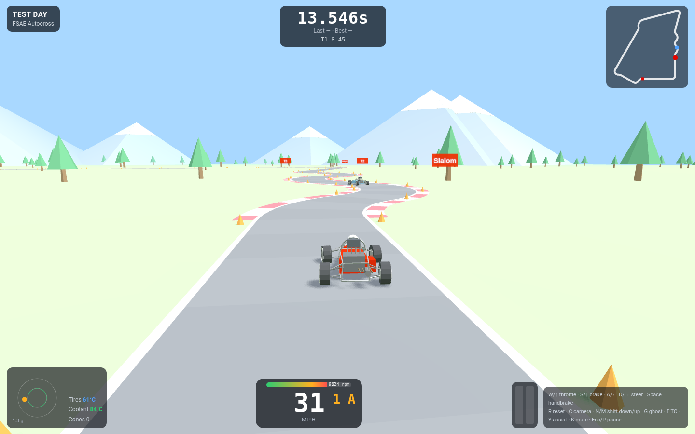
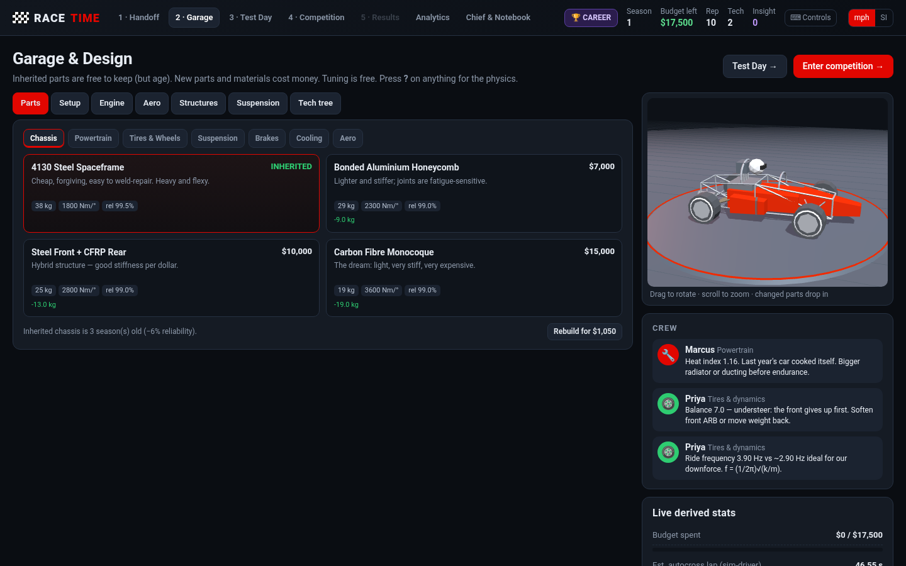
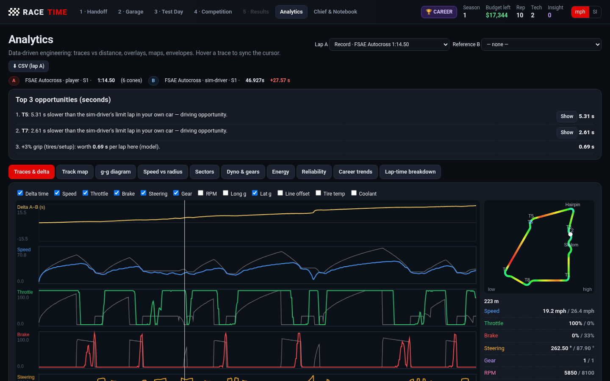
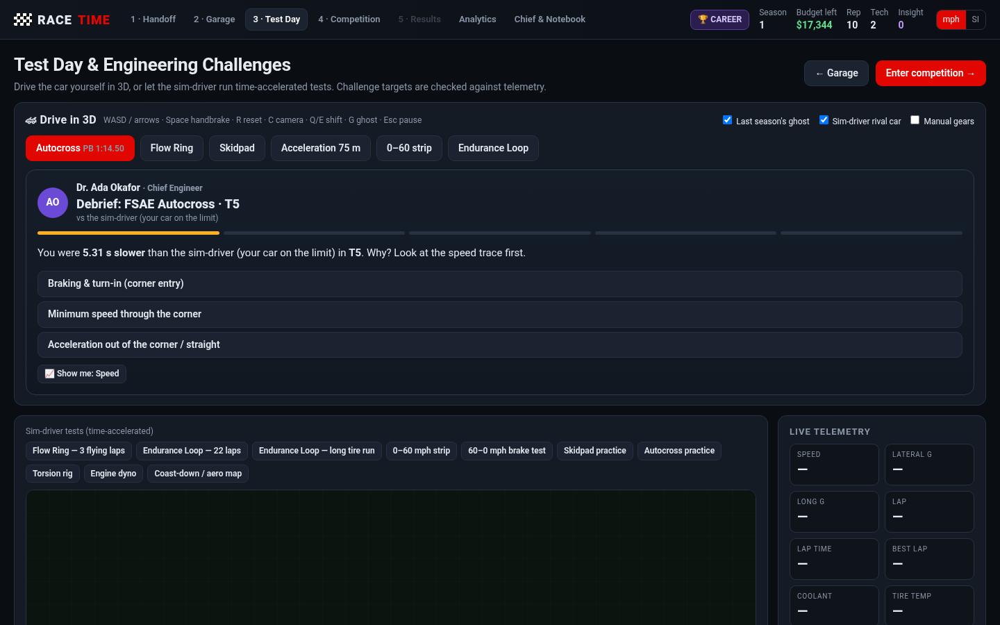
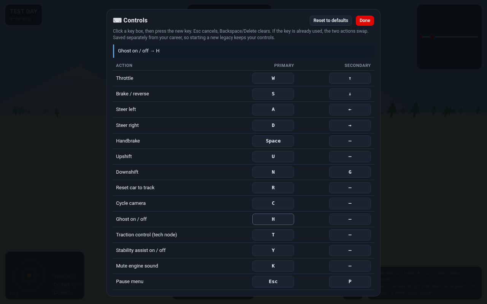

# 🏁 Race Time

**A Formula SAE / Formula Student legacy simulator.** Run a student race team across seasons: design the car, take it to Test Day, drive it yourself in 3D, read the data like a real race engineer, and hand the program to next year's team.

- **Drive it in 3D** – arcade-friendly but physics-based (tyre friction circle, weight transfer, gearing, aero). Acceleration, skidpad, autocross and endurance events, with ghost laps.
- **Engineer it** – engine, aero, suspension, tyres and a tech tree. Every change has a trade-off.
- **Chief Engineer** – your mentor won't just hand you answers. Socratic sign-off gates make you explain *why* a change should work before it goes on the car.
- **MoTeC-style analytics** – speed traces, sector deltas, throttle/brake overlays and a "top 3 places you lost time" breakdown.
- **Legacy** – graduate, pass the notebook on, and see how the program grows season after season.

| Driving | Garage |
|---|---|
|  |  |
| **Analytics** | **Chief Engineer** |
|  |  |

## ⬇️ Download

Grab the latest build from the **[Releases page](https://github.com/matjns/race-time/releases/latest)**:

| File | For |
|---|---|
| [`RaceTime-mac-arm64.zip`](https://github.com/matjns/race-time/releases/latest/download/RaceTime-mac-arm64.zip) | Macs with Apple Silicon (M1, M2, M3, M4) |
| [`RaceTime-mac-x64.zip`](https://github.com/matjns/race-time/releases/latest/download/RaceTime-mac-x64.zip) | Intel Macs |
| [`RaceTime-web.zip`](https://github.com/matjns/race-time/releases/latest/download/RaceTime-web.zip) | Any computer with a modern browser |

Not sure which Mac you have? Apple menu  → **About This Mac**. "Chip: Apple M…" means arm64; "Processor: Intel" means x64.

### Install on Mac
1. Download the zip for your Mac and double-click it to unzip.
2. Drag **RaceTime.app** into your **Applications** folder.
3. Open it. The first time, macOS will block it, because the app isn't signed by a registered Apple developer.
4. Go to ** → System Settings → Privacy & Security**, scroll down, and click **Open Anyway** next to the RaceTime message. Confirm with **Open**.
   *(Shortcut on older macOS: right-click the app → Open → Open.)*
5. If macOS says the app is "damaged", run this once in Terminal, then open it again:
   ```
   xattr -cr /Applications/RaceTime.app
   ```

Your career saves itself automatically.

### Web version
Unzip `RaceTime-web.zip` and open **`index.html`** in Chrome, Edge, Firefox or Safari. Nothing to install, and it works offline. (You can also clone this repo and open `index.html`.)

## 🎮 Controls

| Action | Default key |
|---|---|
| Throttle | W / ↑ |
| Brake / reverse | S / ↓ |
| Steer | A D / ← → |
| Handbrake | Space |
| Upshift / downshift | **M / N** |
| Reset car to track | R |
| Cycle camera | C |
| Ghost on/off | G |
| Traction control (once unlocked) | T |
| Stability assist | Y |
| Mute | K |
| Pause menu | Esc / P |

**Every key can be remapped.** Click **⌨ Controls** in the top bar, on the Test Day screen, or in the pause menu while driving. Click a key box, then press the new key. Each action gets a primary and a secondary key, conflicts swap automatically, and there's a reset-to-defaults button. Your bindings are saved separately from your career, so starting a new legacy keeps them.



## Building from source
The game is plain HTML/JS (three.js is vendored in `vendor/`), so there's no build step for the web version. The Mac apps are packaged with Electron: `build.sh` uses `@electron/packager` and writes the zips to `dist/`.
